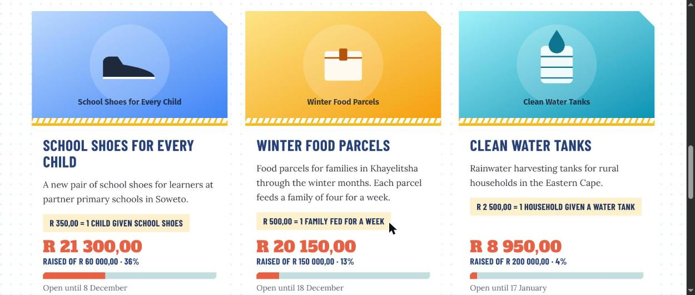
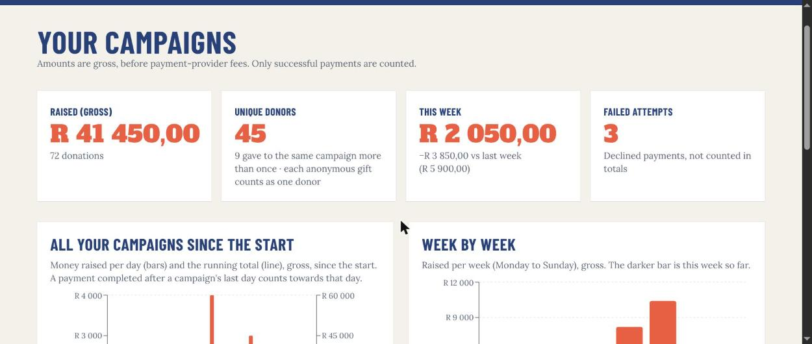

# Donation Manager

A donation platform for a small South African charity: public campaign pages, once-off card
donations through Stripe (test mode), donor accounts with email receipts, and staff dashboards with
charts and CSV reports. Currency is ZAR only.

Built as a 5-day assessment for the **"Payments and people"** brief: take card payments safely
(no double charges, failed payments handled, card details never touched), give each kind of user
the right view of the data, and protect donor privacy. In the brief a "funder" is a donor here.
How it was planned and built: [docs/PLAN.md](docs/PLAN.md) and [docs/PROGRESS.md](docs/PROGRESS.md).



## Who uses it

| Role | Can |
| --- | --- |
| Visitor / guest donor | Browse campaigns, donate without an account, get a receipt link by email |
| Donor (account) | See their own donations, impact and campaign progress, reveal their name on an anonymous gift, download their donations |
| Campaign manager | See dashboards for **their own** campaigns only: progress, donors (anonymous ones masked), failed attempts, charts, CSV export |
| Super admin | Everything a manager sees for **all** campaigns, plus create/edit campaigns and manager accounts |

## Running locally

### Prerequisites

- **Node.js 20.9 or newer** (developed on Node 24; `.nvmrc` included)
- **Docker** with Docker Compose (runs Postgres and Mailpit, a local inbox that catches every email)
- **Only to take payments:** a free [Stripe account](https://dashboard.stripe.com/register) (test mode
  is enough, no business details needed) and the [Stripe CLI](https://docs.stripe.com/stripe-cli)

### 1. Set up and start

```bash
git clone https://github.com/Steffahn1/donation_manager.git
cd donation_manager
cp .env.example .env            # works as-is for everything except payments
docker compose up -d            # Postgres + Mailpit (inbox at http://localhost:8025)
npm install                     # also generates the Prisma client
npx prisma migrate deploy       # creates the tables
npx prisma db seed              # demo users, 5 campaigns and six weeks of donations (wipes the DB!)
npm run dev                     # http://localhost:3000
```

### 2. Log in with the demo accounts

All seeded data is made up.

| Role | Email | Password |
| --- | --- | --- |
| Super admin | `admin@charity.local` | `ChangeMe123!` |
| Campaign manager | `thandi@charity.local` (2 campaigns) or `johan@charity.local` (3 campaigns) | `Manager123!` |
| Donor | `donor@example.com` | `Donor123!` |

**Without Stripe keys** you can already try almost everything: browse campaigns, log in as each role,
the dashboards, charts and CSV exports, and the donor signup (open the confirmation email in Mailpit
at http://localhost:8025). Only the final "pay" step needs Stripe.

### 3. Turn on payments (optional)

1. In the Stripe dashboard (test mode), copy your test keys from
   [API keys](https://dashboard.stripe.com/test/apikeys) into `.env`: `STRIPE_SECRET_KEY` (`sk_test_…`)
   and `NEXT_PUBLIC_STRIPE_PUBLISHABLE_KEY` (`pk_test_…`).
2. In a second terminal, forward Stripe's webhooks to the app:

   ```bash
   stripe login
   stripe listen --forward-to localhost:3000/api/webhooks/stripe
   ```

   Copy the `whsec_…` it prints into `STRIPE_WEBHOOK_SECRET` in `.env`, then restart `npm run dev`.
   Keep `stripe listen` running: without it, payments stay on "Processing" because the app never hears
   back from Stripe.
3. Donate on any open campaign with a test card. Use any future expiry date (e.g. `12/34`), any CVC and
   any postcode:

| Card | Result |
| --- | --- |
| `4242 4242 4242 4242` | Paid |
| `4000 0025 0000 3155` | Asks for 3-D Secure (click **Complete**), then paid |
| `4000 0000 0000 0002` | Declined |
| `4000 0000 0000 9995` | Declined: insufficient funds |

Worth trying: pay with the declined card, then `4242…` on the same page (it stays one donation); an
amount with a decimal comma like `250,50`; and the receipt email in Mailpit after paying.

### Checks

```bash
npm test             # unit tests (payment, privacy, metrics, exports, forms)
npm run typecheck
npm run lint
npm run build
```

### Resetting the demo

`npx prisma db seed` wipes the database and recreates the demo data at any time.

## How a donation is paid

1. **Details** (`/donate/[slug]`): amount, name, email, "give anonymously". Validated on the server; the
   campaign must be `ACTIVE` and today within its dates.
2. **Please confirm**: a summary with a warning that accidental donations cannot be refunded. Nothing
   is stored before this step.
3. **Confirm and pay**: creates a `PENDING` donation and a hosted Stripe Checkout Session, then
   redirects to Stripe. We never see card details. If Stripe can't be reached, the donation stays
   `PENDING` (it is not a declined payment). If the request never reached Stripe the donor can press
   the button again; otherwise they review the donation again.
4. **Webhook** (`/api/webhooks/stripe`): the only place a donation becomes `SUCCEEDED`. The success
   page just reads the status and refreshes until the webhook has arrived.

| Event | Effect |
| --- | --- |
| `checkout.session.completed` (paid, amount matches) | `PENDING`/`FAILED` → `SUCCEEDED` |
| `payment_intent.payment_failed` | `PENDING` → `FAILED`, with the decline reason |
| `checkout.session.expired` | `PENDING` → `EXPIRED` |

Only `SUCCEEDED` donations count towards any total. `FAILED` attempts are kept so staff can see them.

### Failed payments

Stripe Checkout shows a declined card on its own page and lets the donor try another card; the
donation is marked `FAILED` meanwhile and becomes `SUCCEEDED` if a retry works. If the donor leaves
instead, `/donate/cancelled` explains they weren't charged and offers **Try again**. That closes the
old Checkout Session at Stripe (so it can't also be paid in another tab) and refills the form from
this browser tab's `sessionStorage`.

### Duplicate payments

- The confirm step, plus the button disabled while submitting and while the browser leaves for Stripe.
- Each confirm screen gets a random attempt id. It is unique on the donation row and is the Stripe
  idempotency key, so a resubmitted confirm form returns the same Checkout Session, not a second one.
  That includes after a decline: the donor goes back to the still-open payment page.
- Per browser and campaign, only the newest open payment page stays payable: after opening its page,
  a request closes older open pages from the same browser (a random cookie, never matched by email,
  so other people giving with the same email are unaffected). Two tabs submitting at once can't both
  stay payable. The rules and their tests are in `src/lib/checkout-flow.ts`.
- Checkout Sessions expire an hour after they are created, so an old payment tab can't be paid much later.
- Every processed webhook event id is stored in `StripeEvent` in the same transaction as the donation
  update. A redelivered or replayed event is ignored.
- Status updates are conditional (`WHERE status IN (...)`), so a late or out-of-order event never
  downgrades a `SUCCEEDED` donation.

## Donor accounts and receipts

- **Sign up** at `/signup` with just an email address. Every signup shows the same "check your email"
  page, immediately, whether or not the address already has an account. The email (open it in Mailpit
  at http://localhost:8025) links to a page where you **choose your name and password and confirm**;
  only submitting that form verifies the address (email scanners open links automatically). Links last
  24 hours and work once. An account has no password until it is confirmed, so nobody can sign up
  with someone else's email and keep access; confirming also ends any other sessions.
- Donations made with that email are linked to the account **only after it is confirmed**, so nobody
  can see someone else's gifts by signing up with their address.
- The donor dashboard shows history, total given, impact and campaign progress. On an anonymous gift
  the donor can choose **Show my name**; that is permanent, and a named gift can't be made anonymous.
- Unconfirmed signups are removed after their link expires (24 hours). If someone started a signup
  with an email the admin later uses for a campaign manager, "Add manager" replaces that unconfirmed
  signup.
- When the webhook marks a donation paid, the donor gets **one receipt email** with a private link
  (`/receipt/[token]`; only a hash of the token is stored). Sending is best effort and never affects
  the payment.

Signup and receipt emails are sent after the response (Next.js `after()`). When self-hosting, stop the
server gracefully (SIGTERM) so pending emails still go out.

## Dashboards and reporting

- **Numbers** (`src/lib/metrics.ts`): gross raised (before payment-provider fees), donations, unique
  and repeat donors, this week vs last week, and new vs returning donors ("returning" = gave to the
  same campaign before this week). Only paid donations count. Days and weeks are Johannesburg time.
- **Charts**: a long-term chart (money per day and the running total since the start) and a
  week-by-week comparison (last 8 Monday–Sunday weeks, this week marked). On the overview and on
  each campaign page. Closed campaigns' charts end on their last day (a payment completed
  after midnight counts on that day, so the running total always matches "Raised"). The
  browser only receives dates, amounts and donation counts (no donor details).
- **CSV exports** with a date range (Johannesburg days, both included; default the last 12 months),
  **paid donations only**:
  - staff: `/api/export/donations.csv?from=…&to=…[&campaign=…]`, scoped like the dashboards; a
    manager asking for another manager's campaign gets an empty file
  - donors: `/api/export/my-donations.csv?from=…&to=…`, their own donations only
  - anonymous donors appear as "Anonymous" with no email; cells that could run as spreadsheet
    formulas are neutralised; 401 when logged out, 403 for the wrong role

## Key decisions

- **The webhook is the only source of "paid".** Pages never mark a donation paid; every status change
  is conditional and replayed events are ignored, so totals can't double-count.
- **Money is integer cents** everywhere; input accepts the South African decimal comma.
- **Duplicate payments** are stopped at four levels: the confirm step, one payment page per confirm
  screen (Stripe idempotency key), newest-page-wins per browser, and idempotent webhooks.
- **Anonymity is per gift and enforced on the server.** Staff pages and CSVs only ever receive
  masked rows, and staff donor counts treat each anonymous gift as its own donor, so the numbers
  can't reveal who gave it. Revealing a name is one-way.
- **Accounts can't be pre-hijacked**: no password until the inbox owner confirms; confirming ends
  other sessions; signup and login take the same time whether or not an account exists.
- **Pure, tested core logic** (metrics, checkout decisions, webhook processing, verification, exports)
  with the database and Stripe injected; the pages and routes are thin wrappers.

## Privacy

- Minimal data: name, email, amount, and the per-gift anonymity choice. Card details never touch
  the app (Stripe Checkout).
- Staff never see an anonymous donor's identity, in pages or exports. Public pages show no donor
  details at all.
- Tokens (sessions, verification links, receipt links) are stored only as SHA-256 hashes; pages with
  tokens in the URL are `noindex` and `no-referrer`.
- Logs contain ids and error codes only, never names, emails or error messages from Stripe.

### Privacy note: the browser cookie

To close a donor's own older payment pages, the app sets a random, httpOnly cookie (`dm_browser`)
when the donor reaches the confirm step. Each new donation stores only a SHA-256 hash of it. The hash
links donations made from the same browser, so it is kept only while a payment page can still be
open: the webhook clears it when a payment completes or a page expires, and anything older than
70 minutes is cleared on the next checkout. Staff screens never show it.

## Design and accessibility



- One design system for every page: navy, coral and yellow; slab numbers, condensed uppercase headings
  and Lora for reading; cut-corner buttons; subtle hover and scroll motion that switches off for users
  who prefer reduced motion. Colours and shared styles live in `src/app/globals.css`.
- Accessibility (WCAG 2.2 AA): every colour pair checked for contrast, a visible focus ring on every
  control, a skip link, visible labels with linked help text on every input, errors announced and
  linked to the field they are about, table headers marked up, named progress bars, 44px touch
  targets, and no sideways scrolling at phone width.


## How this was built

Built with [Claude Code](https://claude.com/claude-code) as a pair programmer, in a
plan → approve → build → review loop:

- **Plan first:** each day started with a written plan (`docs/PLAN.md`) that I approved before any code.
- **Project rules** in `CLAUDE.md`: money in cents, only the webhook marks a donation paid, anonymous
  donors masked on the server, made-up data only, and so on.
- **Independent review:** a reviewer agent (`.claude/agents/steffahns-code-reviewer.md`) reviewed each
  day's work; its findings were fixed and re-reviewed before merging (pull requests #1–#7).
- **Project skills** (`.claude/skills/`), reusable checklists:
  - `/access-review`: audits every page, action and route for role checks, campaign scoping and anonymous masking
  - `/test-payment-flow`: guided run through the Stripe test cards, checking the database and Mailpit after each
  - `/ui-design-system`: the design and accessibility rules every page follows
  - `/demo-reset`: wipes and reseeds the local demo, then prints logins and test cards

## Limitations

- Tested with unit tests, real Stripe test-mode payments and webhooks, and by hand in the browser for
  every role at desktop and phone width (see docs/PROGRESS.md). There are no automated browser
  (end-to-end) tests or database integration tests yet.
- No rate limiting (signup emails, login attempts).
- Anyone with database access can read donor details; there is no column encryption.
- Tokens in URLs (`/verify-email?token=…`, `/receipt/<token>`) can appear in hosting access logs.
- Receipt emails are best effort: a failed email is not retried, and its link is lost.
- Blocked staff pages return HTTP 200 (showing "not found" or redirecting in the browser) because
  the page starts streaming before the access check; no data is shown.
- Dashboard numbers are computed in memory from paid donations: fine for a small charity, but would
  move to SQL aggregation at large volumes.
- "Newest payment page wins" works per browser; two different browsers can each have an open page.

## Future work

Recurring donations, campaign image upload, a retry queue for emails, rate limiting, column
encryption for donor details, 404/redirect status codes for blocked pages, deleting expired
sessions, and database-level integration tests for the query filters.
