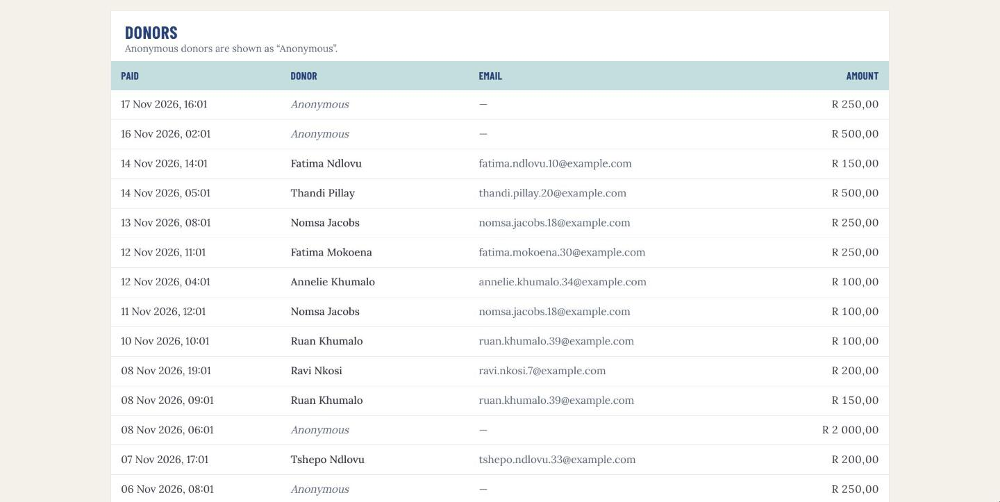
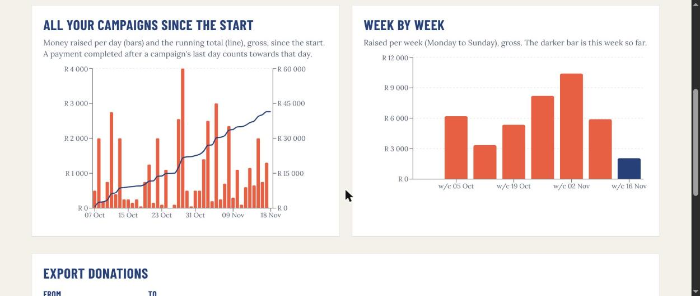

# Donation Manager

A donation platform for a small South African charity: public campaign pages, once-off card
donations through Stripe (test mode), donor accounts with email receipts, and staff dashboards with
charts and CSV reports. Currency is ZAR only.

Built as a 5-day assessment for the **"Payments and people"** brief: take card payments safely (no
double charges, failed payments handled, card details never touched), give each kind of user the right
view of the data, and protect donor privacy. The brief's "funders" are called donors in this app.


## For reviewers: start here

1. **Run it** in a few minutes with the demo accounts: [Running locally](#running-locally) (Stripe keys
   are only needed for the final "pay" step).
2. **Read the decisions** below, then the five files where they live:
   - `src/lib/stripe-webhook.ts`: the only code that can mark a donation paid; idempotent and conditional
   - `src/lib/checkout-flow.ts`: how duplicate payments are prevented
   - `src/lib/privacy.ts`: how anonymous donors are masked for staff, on the server
   - `src/lib/access.ts` + `campaignScopeFor` in `src/lib/campaigns.ts`: who may see what
   - `src/lib/metrics.ts`: dashboard numbers (only paid donations count)
3. **Go deeper:** [docs/ARCHITECTURE.md](docs/ARCHITECTURE.md) (code map, payment flow, accounts,
   reporting, privacy), [docs/PLAN.md](docs/PLAN.md) (requirements and design) and
   [docs/PROGRESS.md](docs/PROGRESS.md) (what was built and tested, day by day).

## Key decisions

- **The webhook is the only source of "paid".** Pages never mark a donation paid; every status change
  is conditional and replayed events are ignored, so totals can't double-count.
- **Money is integer cents** everywhere; input accepts the South African decimal comma (`250,50`).
- **Duplicate payments** are stopped at four levels: a confirm step, one payment page per confirm
  screen (Stripe idempotency key), newest-page-wins per browser, and idempotent webhooks.
- **Anonymity is per gift and enforced on the server.** Staff pages and CSVs only ever receive masked
  rows, and staff donor counts treat each anonymous gift as its own donor, so the numbers can't reveal
  who gave it. Revealing your name is one-way.
- **Accounts can't be pre-hijacked:** no password until the inbox owner confirms; confirming ends other
  sessions; signup and login take the same time whether or not an account exists.
- **Pure, tested core logic** (payments, webhooks, privacy, metrics, exports) with the database and
  Stripe passed in; pages and routes are thin wrappers. 236 unit tests.

## Who uses it

| Role | Can |
| --- | --- |
| Visitor / guest donor | Browse campaigns, donate without an account, get a receipt link by email |
| Donor (account) | See their own donations, impact and campaign progress, reveal their name on an anonymous gift, download their donations |
| Campaign manager | See dashboards for **their own** campaigns only: progress, donors (anonymous ones masked), failed attempts, charts, CSV export |
| Super admin | Everything a manager sees for **all** campaigns, plus create/edit campaigns (including each campaign's "Learn more" article) and manager accounts |

## Running locally

### Prerequisites

- **Node.js 22.12 or newer** (24 recommended; see `.nvmrc`)
- **Docker** with Docker Compose (runs Postgres, and Mailpit: a local inbox that catches every email)
- **Only to take payments:** a free [Stripe account](https://dashboard.stripe.com/register) in test
  mode and the [Stripe CLI](https://docs.stripe.com/stripe-cli)

### 1. Set up and start

```bash
git clone https://github.com/Steffahn1/donation_manager.git
cd donation_manager
cp .env.example .env            # works as-is for everything except payments
docker compose up -d            # Postgres + Mailpit (inbox at http://localhost:8025)
npm install                     # also generates the Prisma client
npx prisma migrate deploy       # creates the tables
npx prisma db seed              # demo users, 5 campaigns and six weeks of donations (wipes the DB!)
npm run dev                     # http://localhost:3000
```

### 2. Log in with the demo accounts

All seeded data is made up.

| Role | Email | Password |
| --- | --- | --- |
| Super admin | `admin@charity.local` | `ChangeMe123!` |
| Campaign manager | `thandi@charity.local` (2 campaigns) or `johan@charity.local` (3 campaigns) | `Manager123!` |
| Donor | `donor@example.com` | `Donor123!` |

**Without Stripe keys** you can already try almost everything: browse campaigns, log in as each role,
the dashboards, charts and CSV exports, and the donor signup (open the confirmation email in Mailpit).
Only the final **Confirm and pay** step needs Stripe: with the placeholder key it shows an error
message and leaves an unpaid (`PENDING`) donation, which is never counted anywhere.

### 3. Turn on payments (optional)

1. In the Stripe dashboard (test mode), copy your secret test key from
   [API keys](https://dashboard.stripe.com/test/apikeys) into `STRIPE_SECRET_KEY` in `.env`
   (it starts with `sk_test_`; the app refuses live keys). The publishable key isn't needed: payment
   happens on Stripe's hosted page.
2. In a second terminal, forward Stripe's webhooks to the app:

   ```bash
   stripe login
   stripe listen --forward-to localhost:3000/api/webhooks/stripe
   ```

   Copy the `whsec_…` it prints into `STRIPE_WEBHOOK_SECRET` in `.env`, then restart `npm run dev`.
   Keep `stripe listen` running: without it, payments stay on "Processing" because the app never hears
   back from Stripe.
3. Donate on any open campaign with a test card. Use any future expiry date (e.g. `12/34`), any CVC and
   any postcode:

| Card | Result |
| --- | --- |
| `4242 4242 4242 4242` | Paid |
| `4000 0025 0000 3155` | Asks for 3-D Secure (click **Complete**), then paid |
| `4000 0000 0000 0002` | Declined |
| `4000 0000 0000 9995` | Declined: insufficient funds |

Worth trying: pay with the declined card, then `4242…` on the same page (it stays one donation); an
amount with a decimal comma like `250,50`; and the receipt email in Mailpit after paying.

### Checks

```bash
npm test             # 236 unit tests (payments, webhooks, privacy, metrics, exports, forms, articles)
npm run typecheck
npm run lint
npm run build
```

### Resetting the demo

`npx prisma db seed` wipes the database and recreates the demo data at any time. Emails already in
Mailpit then point at deleted data; clear the inbox in the Mailpit UI.

## How it works

1. A donor fills in the amount and their details, then sees a **confirm** step (nothing is stored
   before it).
2. **Confirm and pay** creates a `PENDING` donation and a hosted Stripe Checkout page; card details
   never reach the app.
3. Stripe's **webhook** marks the donation `SUCCEEDED` (or `FAILED` / `EXPIRED`) and a receipt email
   goes out. Only `SUCCEEDED` donations count in any total, chart or export.
4. Staff see dashboards scoped to their campaigns, with anonymous donors masked; donors see their own
   history and can download it.

Details, including every duplicate-payment safeguard, the account flow and the privacy design, are in
[docs/ARCHITECTURE.md](docs/ARCHITECTURE.md).



## Design and accessibility

- One design system across every page: navy, coral and yellow; slab numbers, condensed uppercase
  headings and Lora for reading; cut-corner buttons; subtle hover and scroll motion that switches off
  for users who prefer reduced motion. Colours and shared styles live in `src/app/globals.css`; the
  rules are written down in [the ui-design-system skill](.claude/skills/ui-design-system/SKILL.md).
- Accessibility follows WCAG 2.2 AA rules: a visible focus ring on every control, a skip link, visible
  labels with linked help text on every input, errors announced and linked to their field, marked-up
  table headers, named progress bars and 44px touch targets.
- **How it was checked:** the contrast ratio of every colour pair was calculated (all at least 4.5:1
  for text, 3:1 for large text and focus rings), every page type was tabbed through with the keyboard,
  and a script confirmed no page scrolls sideways at 375px. Not yet done: an automated audit (axe or
  Lighthouse) and a screen-reader test.



## How this was built

I used [Claude Code](https://claude.com/claude-code) as a pair programmer and owned the design and the
decisions. The workflow:

- **Rules first.** I wrote down what the code must never break in [CLAUDE.md](CLAUDE.md): money in
  integer cents, only the webhook marks a donation paid, anonymous donors masked on the server,
  made-up data only, plan before building.
- **Plan, then build.** Each day started with a plan ([docs/PLAN.md](docs/PLAN.md)) that I reviewed and
  changed before any code was written. Product questions came back to me instead of being guessed.
- **Independent review.** Every branch was reviewed by a separate
  [code-review agent](.claude/agents/code-reviewer.md) with a fixed checklist (money, duplicates,
  access, privacy, tests). I decided which findings to fix, the fixes were reviewed again, and I merged
  each pull request myself (#1–#7).
- **Checked for real.** I ran the payment flow end to end with the Stripe CLI and test cards, and
  clicked through every role in the browser.

Decisions I made along the way, for example:

- **"Show my name" is one-way.** A donor can reveal their name on an anonymous gift, but a gift staff
  have already seen named can never be hidden again.
- **Staff see the name typed for each gift,** not the account name, because one email can be shared
  (e.g. by a household).
- **Exports contain paid donations only,** and the dashboards show both a long-term chart and a
  week-by-week comparison.
- **A password is only set after the email is confirmed,** so nobody can create an account with someone
  else's address and keep access.

Reusable project skills (checklists the agent follows) live in `.claude/skills/`:
[`/access-review`](.claude/skills/access-review/SKILL.md) (audits role checks, campaign scoping and
masking), [`/test-payment-flow`](.claude/skills/test-payment-flow/SKILL.md) (guided Stripe test-card
run), [`/ui-design-system`](.claude/skills/ui-design-system/SKILL.md) and
[`/demo-reset`](.claude/skills/demo-reset/SKILL.md).

## Limitations

- Tested with unit tests, real Stripe test-mode payments and webhooks, and by hand in the browser for
  every role at desktop and phone width (see docs/PROGRESS.md). There are no automated browser
  (end-to-end) tests or database integration tests yet.
- No rate limiting (signup emails, login attempts).
- Anyone with database access can read donor details; there is no column encryption.
- Tokens in URLs (`/verify-email?token=…`, `/receipt/<token>`) can appear in hosting access logs.
- Receipt emails are best effort: a failed email is not retried, and its link is lost.
- Blocked staff pages return HTTP 200 (showing "not found" or redirecting in the browser) because the
  page starts streaming before the access check; no data is shown.
- Dashboard numbers are computed in memory from paid donations: fine for a small charity, but would
  move to SQL aggregation at large volumes.
- "Newest payment page wins" works per browser; two different browsers can each have an open page.

## Future work

Recurring donations, campaign image upload, images inside campaign articles, a retry queue for emails, rate limiting, column encryption
for donor details, 404/redirect status codes for blocked pages, deleting expired sessions, and
database-level integration tests for the query filters.
